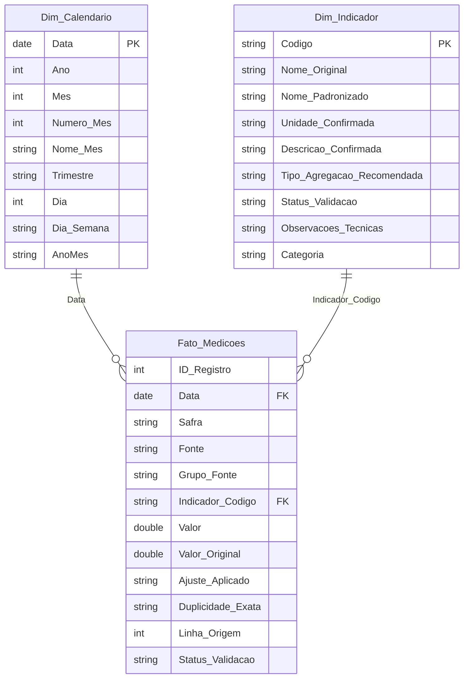

# Modelo de dados

## Visão geral

Modelo estrela simples, com uma fato, duas dimensões de análise e três tabelas de apoio que não participam da navegação analítica principal.



Tabelas de apoio, sem relacionamento com a fato:

| Tabela | Linhas | Papel |
| --- | --- | --- |
| `Auditoria_Dados` | 1.585 | Histórico da normalização de escala de PC e ArCana |
| `Pendencias_Validacao` | 4 | Pendências técnicas declaradas pela origem |
| `Resumo_Qualidade` | 1 | Resumo oficial da carga, oculta no modelo |
| `_Medidas` | 0 | Tabela sintética que hospeda as 55 medidas |

## Relacionamentos

| De | Para | Cardinalidade | Direção | Finalidade |
| --- | --- | --- | --- | --- |
| `Fato_Medicoes[Data]` | `Dim_Calendario[Data]` | muitos para um | simples | Filtrar medições por data, mês, trimestre e ano |
| `Fato_Medicoes[Indicador_Codigo]` | `Dim_Indicador[Codigo]` | muitos para um | simples | Filtrar medições por indicador e trazer unidade, agregação e status |

Nenhum relacionamento é bidirecional. Nenhum é muitos para muitos. Ambos são ativos.

`Dim_Calendario` está marcada como tabela de data (`dataCategory: Time`), com uma linha por dia e cobertura contínua de 01/01/2026 a 31/12/2026.

## Por que `Auditoria_Dados` não tem relacionamento

A tabela tem uma linha por medição afetada e `ID_Registro` único, então um relacionamento um para um seria tecnicamente possível. Ele não foi criado por dois motivos:

1. Relacionamento um para um no Power BI não é o caminho natural para enriquecer uma tabela de detalhe e costuma confundir quem monta visuais depois.
2. A ligação só é necessária em uma página, para um registro por vez.

No lugar, existem quatro medidas que consultam a auditoria sob demanda:

```dax
Regra de Transformacao do Registro =
LOOKUPVALUE (
    Auditoria_Dados[Regra_Transformacao],
    Auditoria_Dados[ID_Registro], SELECTEDVALUE ( Fato_Medicoes[ID_Registro] )
)
```

O mesmo padrão vale para `Fator Aplicado do Registro`, `Valor Original do Registro` e `Status Anterior do Registro`. Todas usam `ID_Registro`, que é único nos dois lados (verificado por teste).

## O que saiu da fato e por quê

A aba `Fato_Medicoes` tem 21 colunas. O modelo mantém 12. As 9 restantes eram atributos de data ou de indicador duplicados dentro da fato:

| Coluna removida | Motivo | Onde está agora |
| --- | --- | --- |
| `Ano`, `Mes`, `Mes_Nome`, `Trimestre`, `AnoMes`, `Dia_Semana` | Atributos de calendário dentro da fato, que quebram a ideia de dimensão única de data | `Dim_Calendario` |
| `Indicador`, `Grupo_Indicador` | Nome e grupo repetidos em 19.532 linhas | `Dim_Indicador[Nome_Original]` e `Dim_Indicador[Categoria]` |
| `Unidade` | Repetida por linha, com zero divergência em relação à dimensão (verificado por teste) | `Dim_Indicador[Unidade_Confirmada]` |

Nenhum valor foi alterado, filtrado ou deduplicado nesse processo. As 19.532 linhas continuam entrando e saindo iguais.

## Colunas derivadas

| Tabela | Coluna | Regra |
| --- | --- | --- |
| `Dim_Indicador` | `Categoria` | "Qualidade da cana" para os 11 códigos medidos nas frentes, "Análise laboratorial" para os 12 do laboratório |
| `Dim_Indicador` | `Ordem` | Índice de origem, oculto, usado apenas para ordenação estável |

## Descrição de coluna e de medida vai em comentário `///`

O TMDL não aceita `description:` como linha de propriedade. A descrição é uma propriedade embutida no objeto e é escrita como comentário de documentação imediatamente acima da declaração:

```tmdl
	/// Chave do indicador. Relaciona com Fato_Medicoes[Indicador_Codigo].
	column Codigo
		dataType: string
		isKey
		sourceColumn: Codigo
```

Escrever `description: ...` dentro do bloco faz o Power BI Desktop recusar o projeto inteiro com `Unsupported property - description is not a supported property in the current context`. Não é erro de ordem nem de aspas: a chave simplesmente não existe no formato.

O validador do repositório pega esse erro antes de abrir o app:

```powershell
powershell -NoProfile -ExecutionPolicy Bypass -File scripts/validate_tmdl.ps1
```

## Comportamento de agregação

`Fato_Medicoes[Valor]` está com `summarizeBy: none`. Essa é uma decisão de segurança, não de estilo: com a soma padrão, qualquer campo arrastado por engano produziria um número somando pH com acidez e ATR. Sem resumo automático, quem monta o visual é obrigado a escolher uma medida.

Todas as medidas que agregam valor usam um único indicador no contexto. Quando o slicer abre em Todos, o modelo aplica explicitamente ATR como recorte exploratório padrão. Ver [MEASURES_CATALOG.md](MEASURES_CATALOG.md).

## Idiomas e formatos

- Cultura do modelo: `pt-BR`.
- `Data` formatada como `dd/mm/yyyy`.
- Percentuais em escala direta usam formato personalizado `0.00"%"`, que exibe 11,71 como 11,71% sem multiplicar o valor.
- `UMIDADE_LAB` usa `0.0%`, formato percentual padrão, porque o dado está em fração decimal.

## Power Query

Todas as consultas seguem o mesmo desenho:

```text
Fonte = Excel.Workbook ( File.Contents ( CaminhoDaBase ), null, true )
TabelaFonte = Fonte{[Item = "tbl_<Aba>", Kind = "Table"]}[Data]
TiposAtribuidos = Table.TransformColumnTypes ( ..., "pt-BR" )
```

O caminho existe em um único lugar: o parâmetro `CaminhoDaBase`, em `definition/expressions.tmdl`.

As abas do Excel já são tabelas estruturadas (`tbl_Fato_Medicoes`, `tbl_Dim_Indicador` e assim por diante), então a consulta navega pela tabela nomeada e não pela posição da planilha. Nenhuma etapa chama `Table.PromoteHeaders`, porque a navegação por tabela estruturada já entrega os cabeçalhos promovidos; chamar de novo transformaria a primeira linha de dados em cabeçalho e corromperia 19.532 registros.

Consultas de uma linha só foram mantidas com nome de etapa explícito, e nenhuma consulta intermediária ficou carregada no modelo: as 6 tabelas carregadas são exatamente as 6 visíveis ou ocultas listadas acima.
